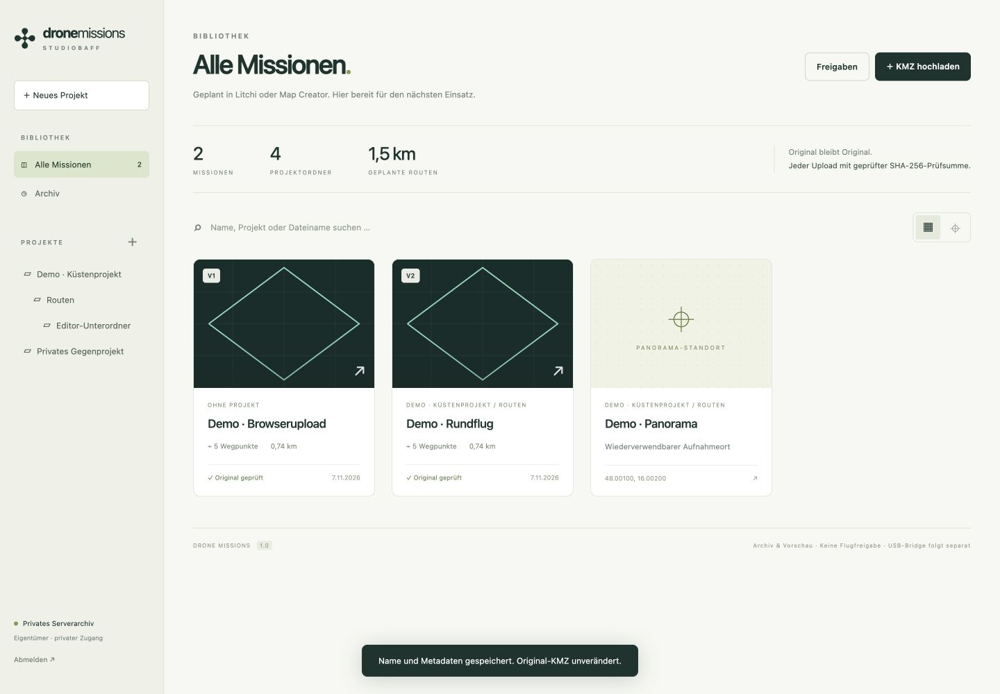

# Drone Missions

Eine private Web-Bibliothek für DJI-WPML-Missionen: Projekte, Original-KMZ, Versionen, Kartenansicht und widerrufbare Projektfreigaben.

Der Web-Quellcode liegt in [`dronemissions/`](dronemissions/README.md). Die Anwendung verwendet PHP 8.3, SQLite und lokal eingebundenes Leaflet; ein Node-Build ist nicht nötig.

- [Funktionen und Grenzen](dronemissions/README.md)
- [Installation und Betrieb](dronemissions/docs/DEPLOYMENT.md)
- [Tests und Prüfbericht](dronemissions/docs/QA.md)

Die USB-/DJI-Fly-Bridge wird separat entwickelt. Es gibt aktuell keine geprüften Bridge-Downloads und keine bestätigte Flugfreigabe. Planungspunkte dienen der Vorbereitung und erzeugen noch keine ausführbaren Panoramaaktionen.

Die Beispiele sind synthetisch. Private Missionen, Zugangsschlüssel, Datenbanken und Serverkonfiguration sind nicht Bestandteil dieses Repositorys.
