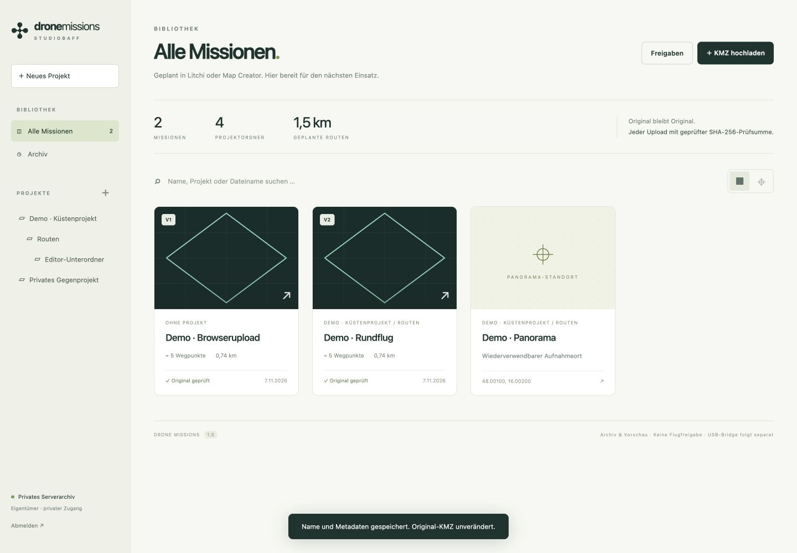
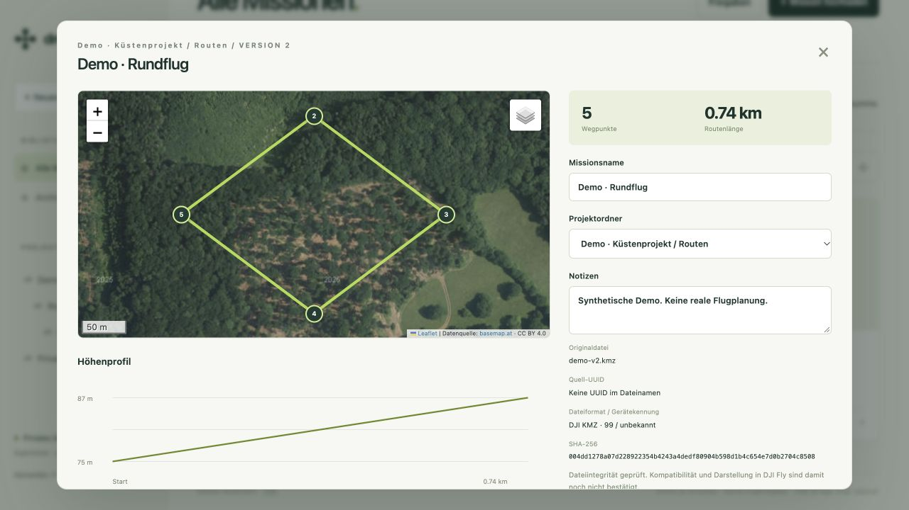

# Drone Missions

Private Web-Bibliothek für DJI-WPML-Missionen aus Litchi Hub oder Map Creator sowie ältere Litchi-CSV-Exporte und native LCHM/LCHZ-Originale. PHP 8.3, SQLite und Vanilla JavaScript; kein Node-Build erforderlich.



## Funktionen

- **Web-Missionsplaner (erste Fassung):** QGIS-/OSM-Umrisse und Zeichnen, Grid, Kreis, Helix/Doppelhelix, POI-Polygon und Fassade, nominelle Überlappungsberechnung, Fotoabschnitte, gespeicherte Planung und DJI-WPML/KMZ-Export mit vorhandenem Geräteprofil. Details und noch offene Geräte-/Terrain-Prüfung: [PLANNER.md](docs/PLANNER.md).

- Projekte und Unterordner mit Pfadnavigation, Suche (Tastenkürzel `/`), Typfilter (KMZ, CSV, Litchi, MPROJ, Punkte), Sortierung, Notizen, Archivieren und Wiederherstellen; leere Ordner löschen.
- Mehrfachauswahl: Missionen gemeinsam in einen Ordner verschieben oder per Ziehen auf einen Projektordner in der Seitenleiste.
- DJI-KMZ, Litchi-CSV, native LCHM/LCHZ und Map-Creator-Projekte (MPROJ) mit unveränderter Originaldatei und SHA-256-Prüfsumme; getrennte Versionen mit Konflikterkennung. Projektdateien lassen sich einer KMZ-Mission zuordnen und landen mit im Archivpaket.
- Je Mission ein Punkt für die Projektkarte mit Navigationslinks (Google Maps, Apple Maps, KML für Google Earth) und optionalem Litchi-Hub-Link.
- Kartenpanel mit Hintergrundkarte, Straßen-Overlay, Adresssuche (Photon, nur auf Absenden) und österreichischen Geozonen (Austro Control ED-269); Standortansicht mit Zonenstatus, Wetterprognose (GeoSphere Austria) und Geländehöhe (EU-DEM). Keine Flugfreigabe.
- Routen und gespeicherte Missionshöhen aus `wpmz/waylines.wpml`; mehrere Flugrouten werden getrennt dargestellt.
- basemap.at und österreichisches Luftbild, OpenStreetMap und Esri-Satellit als weitere Kartenebenen.
- Originaldatei (KMZ/CSV/LCHM/LCHZ) und ZIP-Archiv mit Vorschau, Manifest und Prüfsummen herunterladen.
- Widerrufbare Projektfreigaben, gültig für 30 Tage inklusive Unterordnern: Kunden sehen nur freigegebene Standorte mit Navigation, Administratoren können hochladen und bearbeiten.
- Wiederverwendbare Planungspunkte mit Höhe, Höhenbezug, Blickrichtung, Gimbalwinkel und gewünschter Panoramaaufnahme.



## Oberfläche

Die Oberfläche ist Vanilla JavaScript ohne Build-Schritt: `public/view.html` (Markup und SVG-Icon-Sprite), `public/style.css` (Design-Tokens, Bausteine, Layout, Dialoge, Responsiv) und `public/app.js` (Zustand, Rendern, Karte, Höhenprofil, Dialoge). Gestaltungsgrundsätze und offene Punkte stehen in [docs/HANDOFF.md](docs/HANDOFF.md). Die Oberfläche arbeitet auf Desktop, Tablet und Telefon (Seitenleiste als Schublade, 16-px-Eingabefelder, sichere Bildschirmränder) und respektiert `prefers-reduced-motion`, `prefers-reduced-transparency` und `prefers-contrast`.

## Eigener Autor / Betreiber

Unter **Einstellungen → Autor / Betreiber** trägt der Eigentümer seinen eigenen Namen oder Firmennamen ein. Der Name erscheint auf dieser Installation und als Autor in neuen Archivpaketen. Ein leeres Feld zeigt die neutrale Oberfläche. Neue Installationen übernehmen keinen fest eingebauten Autor; optional kann beim CLI-Setup `authorName` mitgegeben werden. Die Einstellung liegt ausschließlich in der privaten Konfiguration.

## Grenzen

Native LCHM/LCHZ-Dateien werden unverändert archiviert und heruntergeladen. Für diese proprietären Formate werden noch keine Wegpunkte, Routen oder Höhenprofile dargestellt und keine DJI-KMZ erzeugt.

Archiv, Vorschau und die erste Planungsfassung erteilen keine Flugfreigabe. Dateiintegrität bestätigt weder DJI-Fly-Kompatibilität noch Flugsicherheit. Das Höhenprofil zeigt gespeicherte Missionshöhen, keine Geländehöhen. Für ältere Litchi-CSV-Dateien wird der Höhenbezug ausdrücklich als nicht verifiziert angezeigt; die ursprünglichen Einstellungen bleiben in der Originaldatei erhalten. Die Strecke berücksichtigt weder Start-/Rückflug noch Aktionspausen. Planungspunkte erzeugen noch keine ausführbaren DJI-Flug- oder Panoramaaktionen. Die USB-/DJI-Fly-Bridge wird separat entwickelt; es werden hier noch keine Bridge-Downloads angeboten.

## Installation

Siehe [Deployment und Betrieb](docs/DEPLOYMENT.md). Nur `public/` wird über HTTPS ausgeliefert. Konfiguration, SQLite-Datenbank, Originaldateien und Sitzungen müssen außerhalb des Webroots liegen. Der PHP-Prozess benötigt Schreibzugriff auf dieses private Verzeichnis.

Voraussetzungen: PHP 8.3+ mit PDO SQLite, ZipArchive, SimpleXML und GD. Webserver-Limits: `upload_max_filesize=16M`, `post_max_size=20M` oder höher. Das Backend begrenzt KMZ auf 16 MiB und optionale Vorschauen auf 3 MiB/16 Megapixel.

## Prüfung

[Tests und Prüfbericht](docs/QA.md) beschreiben automatisierte API-Tests und Browser-QA. Der Integrationstest schreibt synthetische Daten und darf nur auf einer separaten, anfangs leeren Testinstallation laufen.

```sh
python3 tests/integration.py --base http://127.0.0.1:8080/dronemissions \
  --access /private/path/test-access.json --allow-test-writes
```

Die Zugangsdatei enthält `{"password":"<langer Testzugangsschlüssel>"}` und gehört weder ins Repository noch in den Webroot.

## Sicherheit und Kartenquellen

Zugangsschlüssel werden mit PHP `password_hash` gespeichert. Eigentümersitzungen laufen nach acht Stunden ab; Projektfreigaben werden bei jeder Anfrage erneut geprüft. Freigabelinks sind Zugangsdaten: Ihr Token wird im URL-Fragment übertragen, anschließend aus der Adresszeile entfernt und serverseitig nur als SHA-256-Hash gespeichert. Die Anwendung verwendet HttpOnly-/SameSite-Cookies, CSRF-Schutz und Begrenzung fehlgeschlagener Anmeldeversuche.

Kartenkacheln werden direkt von den jeweiligen Anbietern geladen; diese erhalten dabei IP-Adresse und angefragte Kartenausschnitte. Es werden keine kompletten KMZ-Dateien an Kartenanbieter gesendet. Quellen: [basemap.at](https://basemap.at/#lizenz), [OpenStreetMap](https://www.openstreetmap.org/copyright), [Esri](https://www.esri.com/). Leaflet 1.9.4 und Leaflet-Geoman 2.20.6 sind lokal eingebunden; Lizenzen siehe `public/vendor/leaflet-LICENSE` und `docs/third-party/leaflet-geoman-LICENSE.md`. Bei aktivierter DEM-Geländeanpassung werden Start-/Flug-/POI-Koordinaten an OpenTopoData gesendet und die Ergebnisse privat zwischengespeichert. [Planer und Genauigkeitsgrenzen](docs/PLANNER.md).

Alle Beispiele und Screenshots verwenden synthetische Missionen. Kundendaten, Zugangsschlüssel und Serverkonfiguration gehören nicht in dieses Repository.

## Bridge-App

Die Mac-Bridge ist nach Anmeldung über den Dialog **Bridge** samt SHA-256-Prüfsumme und Archiv-Konfiguration verfügbar. Sie überträgt DJI-KMZ-Dateien per USB und bietet 3D-/Luftbild-/eigene Titelbilder. Bedienung, Menüleiste, Zugangsschlüsselspeicher und bekannte Grenzen: [Bridge bedienen](docs/BRIDGE.md).

Das Browser-Favicon und das Symbol für gespeicherte Webseiten verwenden dasselbe Routen-Icon wie die Bridge-App.
