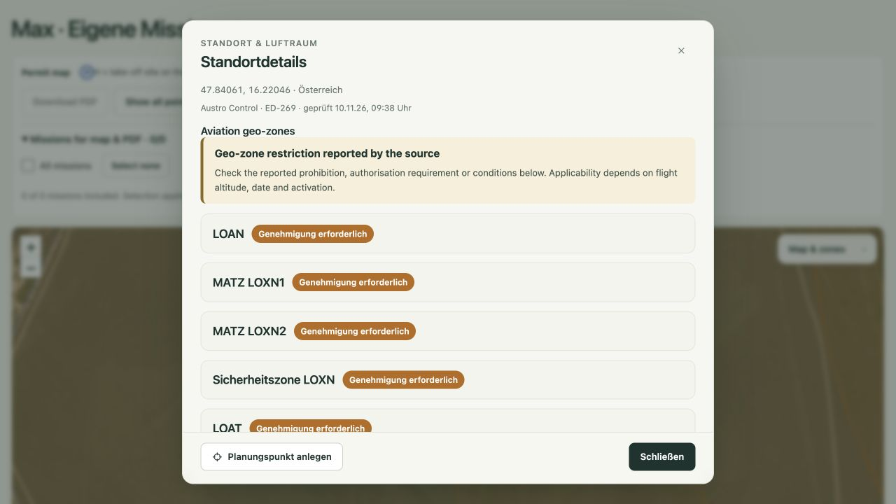
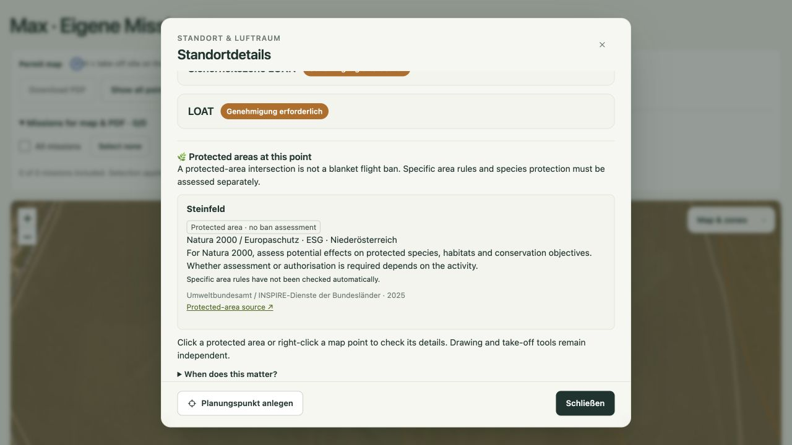

# Überlappende Zonen: Produktion und Browserprüfung

Am 10. November 2026 wurde die Flächenreihenfolge korrigiert und die gemeinsame Standortanzeige auf Produktion im Browser bestätigt.

## Verhalten

- Große Geozonen werden zuerst gezeichnet, kleine danach. Die relative Polygonfläche berücksichtigt Löcher und MultiPolygone.
- Schutzgebiete liegen in Leaflet auf Ebene 370 unter den Flugzonen (380). Ihre Füllung ist mit 0,07 transparenter.
- Auch Schutzgebiete werden über alle geladenen Kategorien hinweg von groß nach klein geordnet, unabhängig von der Antwortreihenfolge der Datenanfragen.
- Ein Kartenklick öffnet die vorhandene gemeinsame Standortansicht. Luftfahrt-Geozonen werden am Punkt ermittelt; Schutzgebiete werden separat am selben Punkt nachgeladen und im selben Dialog ergänzt.
- Der Standortdialog öffnet sich auch bei eingeschaltetem Naturschutz und ausgeschalteten Geozonen. Zeichen- und Startplatzwerkzeuge behalten Vorrang.
- Bestehende Übersetzungen, eigene Kartenebenen, Naturschutzabfragen und Hinweise zur rechtlichen Einordnung bleiben erhalten.

## Produktiver Browsernachweis

URL: https://service.studiobaff.com/dronemissions/?map=1&nature=1&center=47.84061,16.22046,16

Am Kartenmittelpunkt **47.84061, 16.22046** wurden Geozonen aktiviert und die Karte angeklickt. Der Dialog zeigte exakt diese Koordinaten sowie gemeinsam:

1. LOAN
2. MATZ LOXN1
3. MATZ LOXN2
4. Sicherheitszone LOXN
5. LOAT
6. Natura 2000 / Europaschutzgebiet **Steinfeld** (ESG, Niederösterreich)

Die Naturschutzabfrage wurde vollständig abgewartet. Flugzonen und Steinfeld erscheinen im selben scrollbaren Dialog. Die Luftfahrtquelle zeigte den Prüfzeitpunkt 10.11.2026, 09:38 Uhr (Europe/Vienna); Schutzgebietsdaten Stand 2025.

Die Gebiete heißen laut Datensatz MATZ und Sicherheitszone; dieser Nachweis behauptet keine zusätzliche, ausdrücklich als CTR bezeichnete Zone. Die Prüfung belegt die kombinierte Anzeige, keine rechtliche Flugfreigabe.

## Deployment und Wiederherstellung

Produktiv wurden ausschließlich `public/zones.js`, `public/nature.js`, `public/view.html` und das serverseitige `release.json` aktualisiert. Die beiden Skripte werden mit `?v=20261110-overlap` geladen. Der Release-Eintrag ergänzt die bestehenden Dateihashes und kennzeichnet die Korrektur; der Basiscommit bleibt erhalten.

Vorheriger und neuer Dateistand sind im privaten Release-Verzeichnis `releases/zone-overlap-20261110-092049` gesichert (Unterordner `before/` und `new/`). Vor jedem Austausch wurde der Live-Inhalt auf konkurrierende Änderungen geprüft. Dateien wurden per temporärer Datei und Umbenennung ersetzt; danach bytegenau sowie für beide Skripte über öffentliches HTTPS verifiziert. Datenbank und private Missionsdaten wurden nicht verändert.

Für einen Rollback dieselben vier Dateien aus `before/` über temporäre Dateien zurückspielen und anschließend die HTTPS-Auslieferung prüfen. Die vier Dateien bilden eine zusammengehörige Version.

## Prüfungen

- JavaScript-Syntaxprüfung beider produktiver Skripte mit `node --check`.
- Zonengeometrie, Datumsfilter und Zeitpläne mit `node dronemissions/tests/zones.js`.
- Ergänzte Regression für Polygonlöcher, MultiPolygonfläche und Reihenfolge großer/kleiner Flächen.
- Produktive Browserprüfung am oben dokumentierten Punkt; Screenshots zeigen zwei Scrollpositionen desselben Dialogs.
